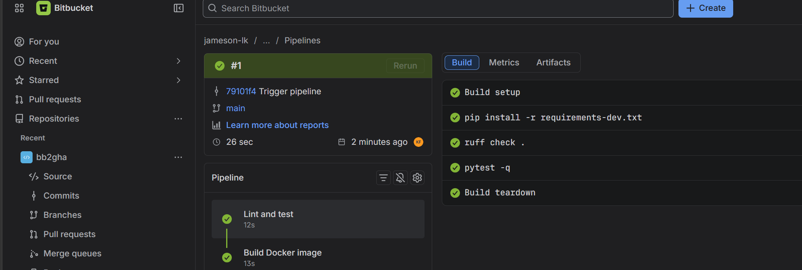
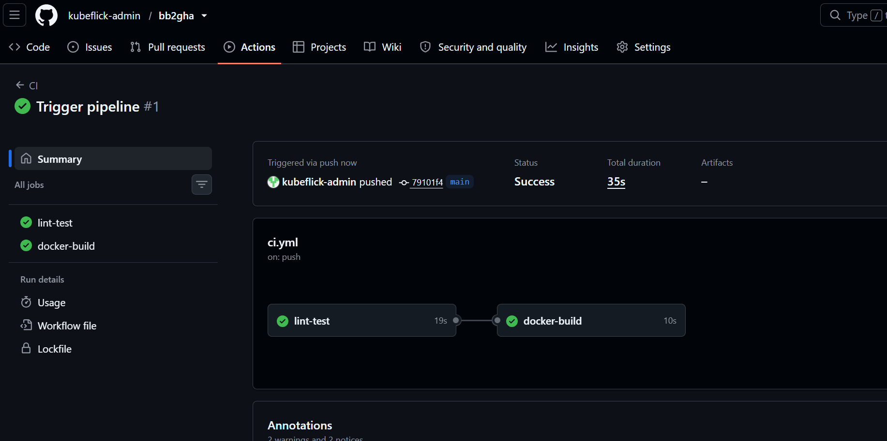

# Bitbucket Pipelines → GitHub Actions Migration

A hands-on project migrating a Python service's CI/CD from Bitbucket Pipelines to
GitHub Actions, then hardening it with OIDC, environments, security scanning,
Terraform and GitOps.

## Roadmap

| Phase | What | JD keywords it proves |
|---|---|---|
| 1 ✅ | Run the legacy Bitbucket pipeline, migrate to GitHub Actions | Workflow-as-code, caching, migration from legacy tooling |
| 2 ✅ | Security scans (CodeQL, Trivy, Dependabot), branch protection | DevSecOps, quality gates, SAST/SCA |
| 3 | Push image to ECR using OIDC (no stored keys) | Secrets + OIDC cloud auth, ECR |
| 4 | Terraform for AWS infra, `plan` on PR / `apply` on merge | IaC, environment approvals |
| 5 | Reusable workflows + composite actions | Standardizing CI/CD, developer self-service |
| 6 | Deploy to ECS / EKS, blue-green, dashboards, budget alerts | Progressive delivery, SRE, FinOps |

## Run locally

```bash
python -m venv .venv && source .venv/bin/activate   # Windows: .venv\Scripts\activate
pip install -r requirements-dev.txt
ruff check . && pytest -q
python -m app.main            # → http://localhost:8080/health
docker build -t bb2gha . && docker run -p 8080:8080 bb2gha
```

## Migration mapping (Bitbucket → GitHub Actions)

| Bitbucket Pipelines | GitHub Actions | Notes |
|---|---|---|
| `bitbucket-pipelines.yml` (one file) | `.github/workflows/*.yml` (many files) | Split by purpose: ci, release, deploy |
| `pipelines.default` | `on: push` | |
| `pipelines.branches.main` | `if: github.ref == 'refs/heads/main'` or `on.push.branches` | |
| `pipelines.pull-requests` | `on: pull_request` | |
| `step` | `job` (runs on its own runner) | Steps inside a job share a filesystem |
| Steps run in order | Jobs run in **parallel** unless `needs:` | Big gotcha when migrating |
| `image: python:3.12` | `runs-on: ubuntu-latest` + `setup-python` (or `container:`) | |
| `caches: - pip` | `setup-python` `cache: pip` or `actions/cache` | |
| `services: - docker` | Docker preinstalled on runner | |
| YAML anchors `&` / `*` | Reusable workflows / composite actions | GitHub doesn't support anchors the same way* |
| Repository variables (secured) | Secrets / Variables (repo, env, org level) | |
| Deployments (test/staging/prod) | Environments + required reviewers | |
| `$BITBUCKET_COMMIT` | `${{ github.sha }}` | |
| Pipes (`atlassian/aws-ecr-push`) | Marketplace actions (`aws-actions/...`) | |
| Self-hosted runners | Self-hosted runners / runner groups | |

\* GitHub added limited YAML anchor support in 2025; reusable workflows are still the standard way to share logic.

## Evidence

| Before: Bitbucket Pipelines | After: GitHub Actions |
|---|---|
|  |  |

## Phase 2: Security gates (DevSecOps)

| Layer | Tool | Type | Where |
|---|---|---|---|
| Source code | CodeQL | SAST | `codeql.yml` |
| Dependencies | Dependabot | SCA | `dependabot.yml` |
| Container image | Trivy | Image/CVE scan | `ci.yml` → docker-build |
| Process | Branch ruleset | Quality gate | Repo settings |

All findings land in one place: **Security → Code scanning**.

**Branch ruleset on `main`:** require a pull request, require status checks
(`lint-test`, `docker-build`, `Analyze (python)`), block force pushes.

### Supply chain notes
- Third-party actions are code you run with your secrets. Pin them to a full
  commit SHA (`uses: owner/action@<40-char-sha> # v1.2.3`), not a tag, because
  tags can be moved. Real examples: `tj-actions/changed-files` (March 2025) and
  `aquasecurity/trivy-action` (2026), both had tags repointed to malicious code.
- Dependabot keeps SHA-pinned actions updated, so pinning doesn't mean going stale.
- `permissions:` is set to read-only at the top; only jobs that need
  `security-events: write` get it.

## Lessons learned
_(Fill this in as you go. Interviewers love this section.)_
